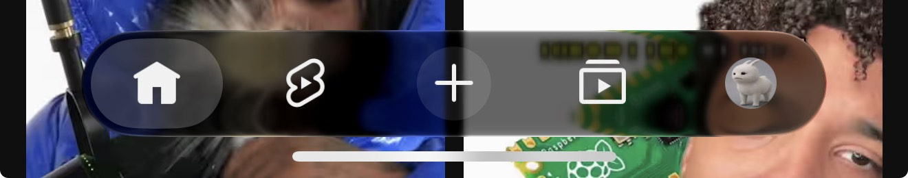
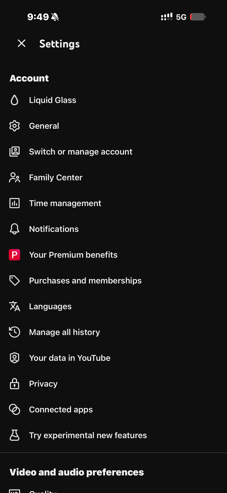
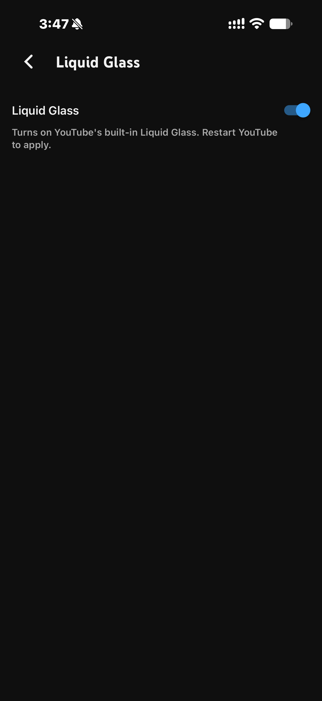

# YTLiquidGlass

Enables YouTube’s New Liquid Glass Tab Bar

> [!WARNING]
> YTLiquidGlass is still in Beta. If there are any bugs, please report it.

## Install

Download the IPA for your iOS version from the [latest release](https://github.com/ReallySprinkles/YTLiquidGlass/releases) and install it with TrollStore, AltStore, SideStore LiveContainer, etc..

## Settings

Open YouTube Settings and choose Liquid Glass.
You can toggle whether you want the tab bar or no.

## Screenshots

  
  
  
  

## Privacy

YTLiquidGlass has no activation service, analytics, telemetry or updater.

## Contributing

Contributions are always welcome — issues and pull requests both help.

For bug reports, include your device, iOS version and YouTube version.

<small>made with ❤️ by gloop</small>

